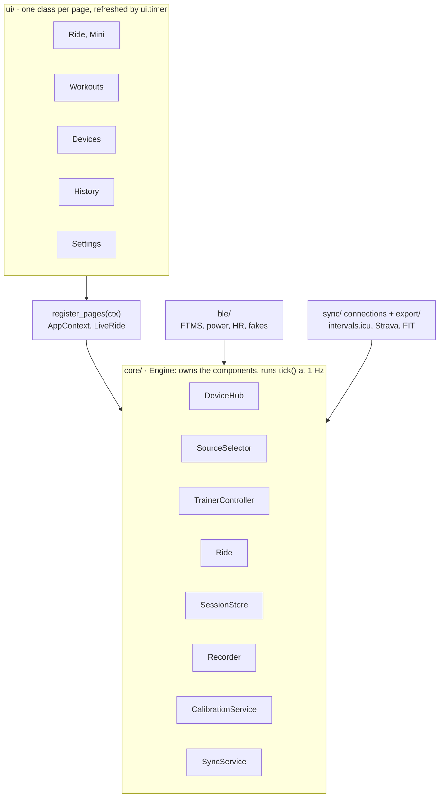
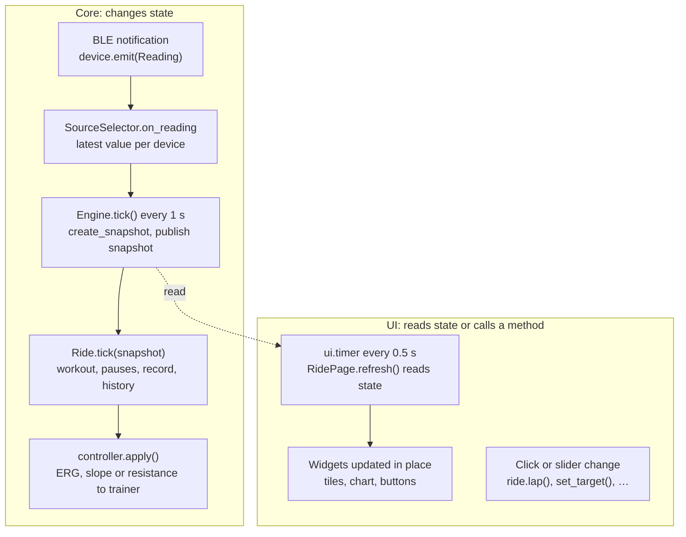

# Architecture: how the core and the UI fit together

The rule behind everything: **the core owns and changes the state; the UI reads it and calls
methods on it.** `core`, `ble`, `export` and `sync` never import `ui`
(`tests/test_architecture.py`). The two sides are connected once at startup and then run their
own loops over the same objects.

## Startup: where things are wired

Everything is built in `smart_trainer/main.py`:

1. **`_build`** loads `Settings` and calls `Engine.from_settings(...)`, the composition root of
   the core. It creates `SourceSelector`, `TrainerController`, `DeviceHub`, `SyncService`,
   `SessionStore`, `CalibrationService` and `Ride`, each with its collaborators injected.
2. It wraps the engine, the settings and the UI-only helpers (`MiniWindow`,
   `StravaAuthorization`) in an `AppContext` (`ui/context.py`).
3. **`register_pages(ctx)`** (`ui/pages/__init__.py`) is the only place the UI reaches into the
   engine. Each `@ui.page` hands its page class only the components it uses.
4. **`_startup`** runs once the event loop exists. It adds the devices (real or fake) and enters
   the engine with `async with`, which starts the 1 Hz loop. Leaving the context stops the loop
   and the devices and leaves an unfinished session recoverable.

### What each page receives

| Page | Gets |
|---|---|
| Ride, Mini | `LiveRide`: `ride`, `controller`, `devices` and a `snapshot()` reader |
| Workouts | `ride`, `sync`, `settings` |
| Devices | `devices`, `calibration`, `settings` |
| History | `store`, `sync`, `messages` |
| Settings | `sync`, `messages`, `settings`, `engine.set_spiral_guard` |

`LiveRide.snapshot` is a function, not a value, because the engine publishes a new `Snapshot`
object every tick. A stored reference would go stale.

## Two loops over the same objects

### Core loop: data in, commands out

- **Readings arrive by callback, not polling.** `DeviceHub.add()` subscribes each device; every
  BLE notification becomes a `Reading` passed to `SourceSelector.on_reading`.
- **Role changes arrive by callback too.** When roles or the trainer change, `DeviceHub` calls
  its `on_change` hook, which `from_settings` wires to `controller.configure`.
- **Each `Engine.tick`** does three things in order:
  1. `selector.create_snapshot(assignment)` resolves the latest readings into one `Snapshot`:
     the effective power, cadence, HR and speed used for control and recording.
  2. `ride.tick(snapshot, ...)` advances the workout, handles auto-pause, switches the
     controller's mode, writes one sample to the SQLite `Recorder` and adds a chart point.
  3. `controller.apply(...)` sends the command to the trainer. It is skipped while a
     calibration spins the trainer down.

### UI loop: read, then call

- **Refresh only reads.** `ui.timer(0.5, page.loop)` calls `RidePage.refresh()`, which reads
  `snapshot()`, `ride.state`, `ride.runner` and `controller.mode` and updates widgets built
  once.
- **User actions are method calls.** Start → `ride.start(...)`, Pause → `ride.toggle_pause()`,
  slider → `controller.set_target(mode, value)`, power source →
  `devices.set_power_source(...)`. The UI never assigns attributes on core objects. The next
  tick acts on the change and the next refresh shows it.
- **Long actions are awaited.** Finish runs `await ride.finish(upload=...)`:
  `SessionStore.finalize` → FIT export → `SyncService.upload`.
- **The core talks back through `engine.messages`**, a shared `deque` the components append
  user-facing messages to. For example, the ride page notes its length before finishing and
  shows each new message as a toast afterwards.

## Shared state across clients

There is one `Engine` per process. Every NiceGUI client (the Mac window, an iPad over `--lan`)
builds its own page objects, which hold only UI state, but they all read the same `ride` and
`controller`. Pausing on the iPad changes state the Mac's next refresh reads; nothing has to be
synchronised.

## Who decides what during a ride

Ride behaviour is spread over a few components, each owning one part:

| Question | Owner |
|---|---|
| Which device's value counts, is it stale? | `SourceSelector` (from `DeviceHub.assignment`) |
| Riding, paused, which workout step, what target? | `Ride` (with its `WorkoutRunner`) |
| Which mode and value the trainer gets, power matching, spiral guard | `TrainerController` |
| Can a ride start, may the trainer be controlled now? | `CalibrationService` (`ride_blocker`, `suspends_control`) |
| Where the samples go, FIT export, crash recovery | `Recorder` and `SessionStore` |
| Uploads and profile sync | `SyncService` over the `sync/` connections |

## Notes

- **`Engine` has two jobs**: composition root (`from_settings`) and the tick loop. This is a
  deliberate choice; it is not a facade, and pages get its components rather than the engine.
- **The ride page and `frame` receive the whole `AppContext`.** `build_ride_page(ctx)` needs the
  window, ride and store for the recovery and mini-window logic, but `RidePage` itself only gets
  `LiveRide`.
- **`DeviceHub` persists its own changes** through its narrow `DeviceConfig` protocol, so
  pairing and role changes are saved without a `settings.update(...)` call.

For how to add a device or a connection, see [README.md → Layout](../README.md#layout).
